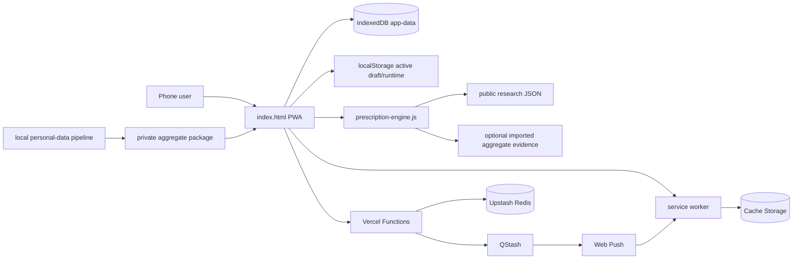
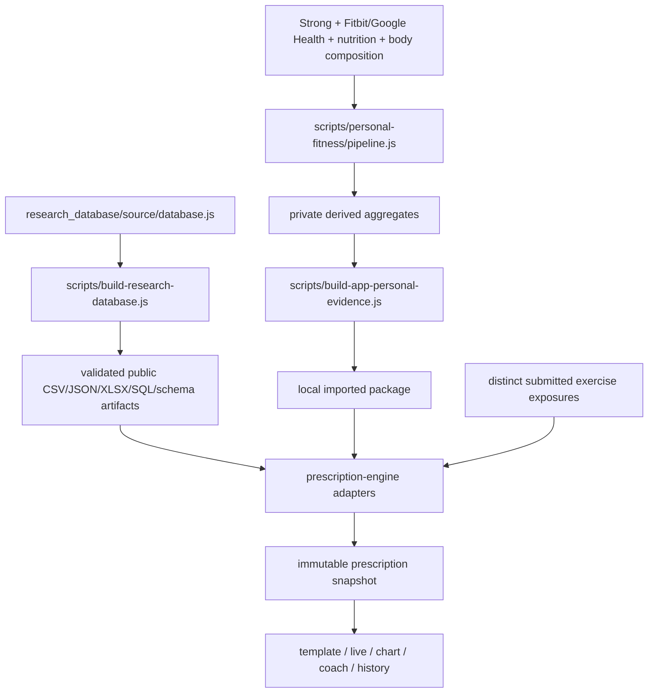

# Architecture

## Metadata

- **Purpose:** Verified technical architecture, data flows, and operational boundaries
- **Last verified:** 2026-07-31
- **Repository:** zero-based redesign M6 active-logger and compatibility boundary
- **Verification status:** VERIFIED locally through the M6 candidate for the two-destination shell, direct Start, one active draft, full-name active logger, shared rest timer, bounded backup/draft recovery, and deleted-surface boundary. Final complete-suite, hosted, and physical-device status remains externally unverified
- **Related:** [Project](PROJECT.md), [decision engine](DECISION_ENGINE.md), [UI/UX](UI_UX.md), [roadmap](ROADMAP.md), [push backend](push-backend.md)

## Living-document rule

Read this document before changing application structure, dependencies, persistence, models, schemas, APIs, authentication, integrations, data flow, builds, deployment, or testing architecture. After implementation and verification, update the affected sections and `ROADMAP.md` in the same task. New source-of-truth files and migrations must be referenced here.

Repository instructions may express an approval preference, but they cannot alter the Codex sandbox or approval policy. Those controls belong to the execution environment; see `AGENTS.md`.

## Stack and repository layout

### Zero-based redesign preservation contracts — IMPLEMENTED LOCALLY

M0 of the adjudicated redesign added declarative target schemas for app data v3, backup v3, active draft v2, resolved action v1, and workout grade v2 under `schemas/redesign-*.schema.json`. Privacy-safe synthetic fixtures under `tests/fixtures/redesign-m0/` cover supported legacy backup versions, legacy mesocycle/equipment fields, historical recommendation/grade/execution-quality records, set-role provenance, and interrupted active-draft state. `scripts/test-redesign-m0-preservation.js` verifies deterministic source-observation preservation, current compatibility round-trips, target version uniqueness, active-draft serialization, and fixture privacy.

Resolved action v1 and active draft v2 are now runtime contracts validated by executable application code; the JSON Schema artifacts document those shapes but are not directly executed as validators. Workout grade v2 remains a declarative target until M7. The executable backup boundary uses backup schema v3 for current app-data v3 and preserves isolated backup-v2 compatibility for app-data v1/v2. Strict app import retains stored historical grade values and versions. Active-draft v1 has a bounded migration reader and is rewritten to v2 only after validated restoration. See `redesign/final/MIGRATION_AND_ACCEPTANCE_PLAN.md` and `redesign/implementation/IMPLEMENTATION_EXECPLAN.md`.

### Zero-based redesign stable-target runtime — IMPLEMENTED LOCALLY

M1 activates app-data version 3 normalization in the existing local-first persistence path. Template exercises are normalized to explicit stable set-role records (`setTypes`) plus set count, rep bounds, target RPE, rest, and increment. Legacy `standardWorkloadOverride` and `standardRoleWorkload` fields are compatibility inputs only; they are decoded into the explicit form and removed from the normalized current model. The normal workout projection consumes that single template/variant source of truth. The recommendation snapshot remains immutable audit/history data but no longer supplies ordinary exact set/load/rep prefills.

Loaded app-data versions 1 and 2 receive an idempotent version-4 migration-audit entry and normalize to app-data version 3. Existing session/exercise/set records, submitted snapshots, IDs, role provenance, planner records, and the separate active-draft recovery boundary remain intact. Legacy global `settings.availableEquipment` is accepted by bounded import for compatibility and discarded during normalization; the application has no active writer or normal workout reader for it. Equipment-only stale execution blocks are cleared at the current logging boundary without rewriting submitted historical recommendation snapshots. The current app has no global exercise-exclusion state or equipment-based logging authorization.

RPE entry uses a bounded replacement buffer so a focused prefilled `7` accepts `7.5` without retaining the original numeric selection. If blur persistence rerenders the set row during a completion touch, delegated pointer handling resumes the action against the freshly rendered set control so the saved decimal and completion transition remain one continuous interaction.

Root runtime assets remain source and `www/` remains generated. M1 synchronizes all 40 public assets and advances the installed-service-worker cache to `comprehensive-fitness-pwa-v95`.

### Planner/mesocycle removal boundary — IMPLEMENTED LOCALLY (M3)

`guided-mesocycle.js`, planner-only schemas, active `data.mesocycles`/`activeMesocycleId` state, planner requests, writers, routes, service-worker references, and current runtime tests are removed. The migration boundary contains an isolated, versioned legacy backup decoder: it accepts obsolete planning keys and maps only the workout/routine-template facts needed for historical understanding. It does not recreate an active planner domain, route, writer, renderer, engine branch, or new-record schema. Plan currently owns routine/template management only; M5 still owns the final shell change.

### Analytical product removal boundary — IMPLEMENTED LOCALLY (M4)

The normal Today/start path no longer invokes or renders hypertrophy, weekly/fractional volume, research-status, evidence, confidence, program-score, or normal plan-preview producers. `app-analysis.js` now owns one factual per-variant performance series/point-detail view and chronological submitted-workout history. Progress subview state and dashboard/scorecard/volume/fatigue/hypertrophy/research recommendation renderers are removed. The shared programming-family ledger and its derived historical-volume execution path are deleted.

This is a derived-code and UI deletion, not a workout-data migration. Submitted sessions, exercises, sets, exact variant identity, set classification, load/reps/RPE, dates, and immutable historical compatibility material remain in local data. Strict import allowlists may still accept obsolete analytical fields as inert historical bytes. The M2 `exception-resolver.js` remains the only live exception-action source and does not consume volume, hypertrophy, confidence, or research-status analysis.

### Two-destination startup and draft boundary — IMPLEMENTED LOCALLY (M5)

`primaryTabIds` contains only `today` and `progress`. Routines and Settings are secondary destinations with bounded legacy redirects; neither is persistent navigation. The active-workout destination is contextual and replaces persistent navigation while its sole draft is active.

Ordinary Start constructs the workout directly with usual readiness. Optional readiness has separate pre-workout and active-workout flows; its update refreshes the canonical resolved action without becoming a Start gate. A second start reaches an active-draft conflict that offers only Resume, Finish, or confirmed Discard, and no replacement workout is created before the existing draft is resolved.

Normal boot loads only the identity catalog compatibility required by exact variant/history matching. M5 does not initialize analytics or research-evidence surfaces, and removed personal-evidence UI has no startup route. Legacy backup decoding remains bounded to workout/session/template facts and immutable historical snapshots; obsolete planner settings are discarded before active import and current export.

This is a dependency-light static PWA with Capacitor wrappers, not a bundled component-framework application.

| Area | Implementation |
| --- | --- |
| Web UI/state | HTML/CSS shell in `index.html`; ordered classic-script runtime segments from `app-foundation.js` through `app.js`; synchronized public copies in `www/` |
| Decision engine | UMD module `prescription-engine.js`; synchronized to `www/` |
| Rest lifecycle | UMD module `rest-completion-controller.js`; synchronized to `www/` |
| Persistence | IndexedDB primary, localStorage migration/fallback and compact active draft |
| Offline/install | `manifest.webmanifest`, `sw.js`, `resources/` |
| Serverless API | CommonJS Vercel Functions under `api/` |
| External services | Upstash Redis, QStash, standards-based Web Push/VAPID |
| Native shells | Capacitor 7 projects under `ios/` and `android/` |
| Research data | Source, schemas, exports, workbook, and validation under `research_database/` |
| Private analysis | Pipeline/config/schemas under `scripts/personal-fitness/` and `personal_fitness_data/` |
| Contracts | JSON Schema files under root `schemas/` |
| Verification | Dependency-free Node tests in `scripts/test-*.js`; Node-based public/private/release gates; Playwright/axe UI audit; GitHub Actions |

`npm run sync:web` is the canonical copy step from root web assets into `www/`. Root files are the editable source; duplicated `www/` files are packaging outputs.

Any cross-file runtime contract change must advance `CACHE_NAME` in `sw.js`. This retires the previous app shell and module assets together; otherwise an installed PWA can pair a new UI with older cached assets.

The service-worker cache version is also the installed-PWA update signal. Every published runtime change must advance it so `registration.updatefound` can surface the in-app update action; changing only a cached shell asset is insufficient. An active worker serves its allowlisted document and runtime assets cache-first without background replacement. The installing worker fills a separate versioned cache, preventing a controlled page from combining JavaScript modules from different releases.

## High-level system

## Frontend and state

`index.html` contains the document shell and semantic component styles. The local-first runtime is segmented by responsibility: foundation/state/persistence/compatibility (`app-foundation.js`), primary views (`app-views.js`), routine/history/factual-progress/settings presentation (`app-analysis.js`), workout mutations (`app-workout.js`), PWA/push/sync/timer integration (`app-sync.js`), grading/submission (`app-history.js`), import/export/readiness aggregation (`app-import.js`), and delegated events/startup (`app.js`). These ordered classic scripts intentionally share the browser global lexical environment; their order is a tested dependency contract. Only Today and Progress are primary destination IDs. Routines and Settings remain contextual, and active workout is a full-screen contextual logger. Progress has no secondary route or subview state: it renders one factual per-variant chart with source-point detail and chronological history. Legacy snapshot/explanation helpers are compatibility readers only and do not feed normal boot, Today/start, or Progress. Views are generated as HTML strings and events are handled at the root through `data-action` delegation.

Because each render replaces the view DOM, focus continuity is represented as an allowlisted data descriptor (`data-action` plus bounded identity fields and ordinal), never as a detached element or caller-provided selector. Initial load does not claim focus; explicit primary navigation targets the focusable `#main-content`. Modal sheets capture their invoking descriptor and verify that the resolved target is visible, enabled, programmatically focusable, and actually focused. A failed resolution or focus attempt falls back to the first visible enabled dialog control; that same filtered set owns forward/reverse Tab trapping. Closing restores the newly rendered durable trigger. Progress point detail is ordinary in-view disclosure state, not a persistent secondary route or dashboard stack.

The narrow large-text layout is activated only when the viewport is at most 380 CSS px and the computed root font is at least 24 px. That exact condition renders editable titles as multiline controls and permits one-column reflow and scaled controls while preserving the protected normal-scale 320 px Lift composition. At ordinary narrow text sizes, an input is upgraded only when its rendered value actually overflows. The quick-template list remains an explicit horizontal carousel; other primary-view content must not create document or nested horizontal overflow.

The production design-system boundary is source-enforced independently of visual baselines. Component rules consume semantic color tokens; raw component hex declarations, literal type below 12 px, misuse of the reserved `--fs-data` step, and retired Workout Board/support selectors fail `scripts/test-design-system-integrity.js`. Screenshot comparison remains separately gated until the owner accepts the complete replacement baseline set, so architectural checks cannot silently approve appearance.

Active Today execution is deliberately one render column. `renderWorkout` owns a top-level rest-timer slot, the exercise document, add/details disclosures, and submission controls; it no longer constructs a parallel session-board/support aside or a repeated bottom recovery-adjustment plan. During execution the sticky shell header owns the visible session heading, state, and current exercise/set identity. The fixed session dock remains the sole owner of completed/total set progress and elapsed time, and the roll-up owns adherence/RPE drift. The retained notification-setup control is visually ordered after the workout document without changing its action or state. Removed Workout Board, status-strip, and support-drawer selectors are absent from production CSS. `renderExercise` keeps the editable name, optional target/confidence chip, grip/menu controls, and native supporting disclosures. `renderSet` projects comparable submitted load × reps @ RPE and date into one full-width Previous strip after the three primary current-set inputs and, when the source session exists, routes that native link through `open-session` to the exact read-only History record. A zero-height-when-closed native set-tools disclosure owns Rest, Skip, Remove, and the nested progression rationale while retaining 44 px activation targets.

The timer remains single-instance runtime state. `startTimer` now projects that state into `.workout-timer-slot` rather than nesting it under the completed set. Pause/resume and adjustment may rotate the timer identifier; DOM synchronization retags the single visible strip, and cancellation removes either the current identifier or the slot-owned fallback before clearing the source set's resting class. The completed set and timer state machine, notification scheduling, next-set selection, persistence, and focus behavior are unchanged. These are presentation projections only: readiness, prescription snapshots, workout mutation guards, persistence, and submission semantics are unchanged.

The M-series raster-fidelity layer is a presentation boundary. Scoped selectors in `index.html` and presentation-owned markup in the existing runtime segments reshape Today, Plan, Progress, More, guided-planner, sheet, history, system-state, dock, and navigation surfaces without introducing routes, persisted fields, domain mutations, scoring rules, or new integration effects. Existing delegated `data-action` commands remain the behavior boundary. Public synthetic browser fixtures in `tests/ui/mockup-fidelity.spec.js` exercise the selected M1 V3, M2–M6 surfaces, M7 dock, and M8/M9 navigation while retaining their functional controls. Literal raster differences that require a data-contract, workflow, or safety change remain documented as **NEEDS REVIEW** and are not implemented.

Mobile active-set inputs retain a final-cascade 16 CSS-pixel font floor so iOS Safari does not focus-zoom while a user enters load, reps, or RPE. The delegated pointer handler releases a focused set-entry control before the completion checkmark receives its default focus transition, and the click path repeats the release as a programmatic/keyboard fallback before `toggleSetCompletion`. This changes focus/viewport presentation only: set mutation, rest timing, persistence, and the rule that set transitions never invoke programmatic scrolling remain unchanged.

Exercise execution defaults are a universal app-owned layer, not a recommendation prerequisite. `renderExerciseGuidance` projects immutable guidance first as a non-form benchmark strip, while `renderStandardWorkloadControls` reads active set rows and renders the separate user-editable plan. Its down/value/up steppers remain native number inputs in the center and route button changes through the existing delegated input/change path. Shared steppers retain their 44 px buttons; advanced individual-set rows use compact 36 px arrow cells and guarantee at least 52 px to the editable value, while sub-360 px layouts stack the two range bounds. The delegated change boundary marks shared defaults authoritative after a shared edit and marks individual targets authoritative after a per-set edit, so a pre-opened top/back-off editor cannot silently override newer shared values. `applyExerciseDefaultTargets` validates against the exercise’s owning active session, validates ordered shared or individual rep and RPE minimum/maximum pairs, preserves completed work, rebuilds unfinished rows, writes exact `targetRepMin`, `targetRepMax`, `targetRpe`, `targetRpeMin`, `targetRpeMax`, `targetRestSeconds`, `setType`, and `sourceTemplateSetId`, advances the owning session timestamp, and appends the same `exercise_default_targets` event to the exercise and top-level audit ledgers. `targetRpe` remains the compatibility upper-bound scalar while the minimum and maximum are authoritative for the editable range. Reusable defaults use the existing bounded template `setTypes` and `warmups` arrays; one set-type record per distinct target preserves duplicate role labels with different ranges, RPE, or rest without a new top-level schema or data migration. Strong-derived templates, templates created from sessions, and updated templates all serialize the same target fields. Backup allowlists already admit those fields. `startTimer` selects the completed set’s `targetRestSeconds` before the exercise fallback, so warm-up, working, and drop-set timers can differ.

Open section-level native disclosures render a compact yellow upward-chevron badge in the summary’s trailing edge. The cue is presentation-only, appears only while the section is expanded, and leaves the summary as the native keyboard- and pointer-operable recollapse target. Compact controls that already own a specialized disclosure indicator retain that indicator instead of receiving a duplicate badge.

Comparable prior-set projections retain both `priorSessionId` and `priorExerciseId`. The Previous link carries that exact historical exercise plus the originating active exercise through the transient navigation context; after each render, the destination exercise card receives programmatic focus and scroll alignment. If that History record temporarily owns Today while `activeWorkoutId` identifies another valid session, `renderWorkout` exposes one fixed return action. Dispatch restores `activeSessionId`, clears the transient History pointer, and focuses the originating active exercise without mutating either workout. The older snapshot-level shared/role override reader remains for compatible backups and already-saved templates: `applyManualOverride`, `standardRoleWorkload`, and `prescriptionSnapshotWithTemplateStandard` can still replay those audited values onto a fresh workout-bound snapshot. New Exercise options writes exact per-set template targets instead and clears `standardRoleWorkload`, avoiding two competing current default shapes while retaining bounded historical reads.

Recommendation-to-workout projection is a single pipeline. `prescription-engine.js` derives the safe latest-load baseline and historical high-watermark context, excluding planned reductions, pain, and invalid technique. `legacyTargetFromSnapshot` carries the immutable final snapshot into workout startup. `setPrescriptionForRole` combines its progression action with the newest comparable role/index to choose exact repetitions, while deriving back-off loads from the same top-load anchor. Those generated rows are persisted on the active workout and remain the authoritative executable targets. The exercise-level claim reads those same live rows to own the human-readable load, repetition target, role composition, working-set structure, and confidence; editable inputs expose the targets for action rather than recomputing them. Role evidence headings count the same live role rows and their facts retain Last performed, Next increment, and the progression gate without creating another target/confidence claim. A partial snapshot is normalized into a derived display object and is never rewritten; values absent from both the snapshot and live rows are omitted instead of inferred. The generic prescription range remains a bound/fallback, not a competing target. This boundary prevents a recommendation card from describing one session while editable controls prepopulate another.

The current normalized app object (`emptyData`, `normalizeLoadedData`) contains sessions, exercises, sets, templates, resolved actions/manual overrides, raw-import metadata, migration audit, revision, and retained settings. Mesocycles, recommendation history, personal-evidence packages, global equipment preferences, and exercise-exclusion arrays are legacy decoder inputs only and are not recreated as active state. Settings include independent `theme` and `colorPackage` values; missing legacy package values normalize to Signal Garden, and backup import accepts only the declared package IDs. `applyTheme` projects both values to document data attributes and a package-specific browser theme color. IDs are UUIDs when supported. Domain migration and set classification preserve required historical semantics.

Exercise identity has two explicit roles. `performanceExerciseId` is the exact identity used to retrieve prior loads and preserve named/equipment variations; `researchExerciseId` is an optional reconciled public identity used for taxonomy and science defaults. `resolveExerciseIdentityProfile` produces both plus `identitySource` and `identityVersion` (`exercise-identity/2.0.0`). A collision-free personal ID is executable even when it predates `custom_`/`user_` prefixes. A reconciled personal crosswalk such as Double Pulley Lat Pulldown keeps its personal performance identity while projecting to the public lat-pulldown research identity. Direct public catalog identity wins over a same-name personal spoof. New/imported exercises persist these fields when present; legacy records resolve them at read time without rewriting submitted history.

IndexedDB database `comprehensive-fitness`, store `state`, key `app-data` is primary. `comprehensive-fitness-data-v1` supports legacy/fallback state; runtime and a compact active draft use separate localStorage keys. Runtime restoration consults its localStorage failed-write fallback when the IndexedDB read fails or succeeds without a runtime record; an existing IndexedDB runtime remains authoritative. Draft writes are debounced and the compact synchronous fallback protects immediate-close recovery. Completed-history calculations use revisioned caches (`scripts/test-performance.js`).

JSON replacement imports are an explicit trust boundary. Full app backups are limited to 50 MiB using both the browser file size and the actual UTF-8 byte count, preserving recovery for legitimate large histories and raw Strong archives; the narrower personal-evidence package remains limited to 8 MiB. Iterative shape validation caps depth/object width and rejects prototype or event-handler keys. Backup records pass versioned top-level/entity allowlists, bounded identifiers/text/collections, duplicate checks, and relationship checks before a canonical replacement is produced. Imported `dataRevision` is optional but, when present, must be a non-negative safe integer; it is never trusted as local ordering authority. An accepted replacement receives exactly the next local monotonic revision. Template numeric values, logged/target set values, classifier metadata, and readiness-baseline values enforce their editor/domain ranges, integer requirements, increments, and ordered min/max pairs before persistence. Imported migration-audit records and nested changes additionally enforce field allowlists, typed/bounded counters, timestamps, IDs, text, and confidence values; every migration value rendered in Settings is HTML-escaped.

Before a full-backup write, every recommendation snapshot that can execute from an active exercise, active workout prescription, or template passes the engine's exported schema/checksum serializer, canonical identity and exact direct-target resolution, and (for exercise/template records) host-exercise identity binding against a prepared candidate engine. Validation does not invoke fresh prescription logic. A stale checksum, unknown schema, identity collision/unresolved identity, unrelated target, or host mismatch rejects the replacement atomically. Submitted historical snapshots are deliberately not reserialized or rewritten; their stored bytes remain historical evidence. Persisted snapshots created by an older runtime may therefore omit fields that a newer renderer recognizes. The display compatibility boundary projects safe strings, arrays, and optional metric ranges in memory only, and both unit and browser tests assert byte-equivalent source state after presentation. A private-evidence replacement likewise reconciles identities from exercise scores, prescriptions, and exercise-muscle scores against the loaded research data and constructs a complete candidate engine before the single IndexedDB write. Any invalid new identity rejects the whole replacement. Only after the candidate write succeeds does the app remove the local fallback, install runtime state, and invalidate the evidence-dependent completed-analysis, recommendation, prescription-snapshot, muscle-assignment, and entity-index caches. Rejection preserves both stores, the previous engine, runtime data, revisions, and caches.

When startup has preserved two valid but unorderable app-data copies, replacement import is blocked: otherwise an accepted import could be shadowed by the alternate on the next load. Export truthfully serializes only the selected runtime copy and identifies the preserved alternate as excluded; confirmed Clear All remains the destructive resolution before importing a replacement. Confirmed clearing inspects only an existing service-worker registration instead of awaiting the potentially never-settling `serviceWorker.ready` promise, cancels queued local saves, removes the IndexedDB database and fallback, durably writes fresh defaults, removes the alternate again, and announces completion only after that write succeeds. Persisted legacy packages are not silently rewritten: an invalid identity stays available to the reconciler for audit while canonical, prescription, muscle, history, and volume consumers fail closed. Import status is attempt-scoped and exposed through an accessible live region. Although IndexedDB is primary, the localStorage fallback may temporarily contain the complete app-data object, including workout history, settings, and an imported personal-evidence package; it is same-device recovery storage, not a privacy-free cache.

**SUPERSEDED HISTORICAL RECORD (M3/M5):** The former Templates/mesocycle/Dashboard/start-flow rendering boundary is retained only as historical performance evidence. Current Routines are contextual, have no mesocycle candidate tree or Dashboard dependency, and direct Start does not construct a readiness prescription or confirmation sheet.

## Workout lifecycle

```mermaid
stateDiagram-v2
  [*] --> Idle
  Idle --> Active: direct Start
  Active --> ActiveConflict: competing Start
  ActiveConflict --> Active: Resume
  ActiveConflict --> SubmitReview: Finish
  ActiveConflict --> CancelReview: Discard
  Active --> Active: edit/complete/skip sets; timers
  Active --> CancelReview: request cancel
  CancelReview --> Idle: confirm cancel
  Active --> SubmitReview: request submit
  SubmitReview --> Active: cancel confirmation
  SubmitReview --> Submitted: confirm submit
  Submitted --> Summary: grade + lifts + PRs
  Summary --> History
  History --> EditDraft: explicit edit
  EditDraft --> Submitted: save edits and recalculate
```

Only `submitted`/completed sessions participate in canonical history (`activeCompletedWorkoutHistory`, `activeHistorySessions`). Direct Start creates one active session from stable routine targets and persists any canonical advisory action; it does not create a new legacy workout prescription or recommendation snapshot. Submission uses a per-session in-progress lock before calculations, so a routed duplicate or a reentrant call cannot duplicate analysis, persistence, sound, feedback, or sync effects. It calculates retained PR/summary facts, timestamps completion, invalidates relevant caches, persists, and queues one sync mutation. Historical snapshots are not silently recomputed after engine changes.

`getMostRecentWorkoutPerformance` is the shared live-workout history boundary. Unlike trend/fatigue analysis, it searches the full submitted archive rather than the six-month active-analysis window, because an old completed exposure is still the user's last recorded performance. A revision/date-keyed index first matches the stable performance identity and resistance type; if identity provenance changed across import/evidence versions, submitted Strong records may additionally match the exact normalized exercise name. This fallback never joins differently named variations. Current-session and deload-ineligible work remain excluded, and returned working sets retain their source session/date. Set-role matching prefers the same role and role index, then uses the same ordered working-set position so Strong classification differences do not erase real prior performance.

Workout construction treats the saved routine and named variant as the stable structure: set roles/count, rep ranges, target-RPE band, rest, resistance mode, and explicit defaults. Factual prefill comes from the corresponding prior set for the same performance identity and role/index, then an explicit routine default, then blank. The sole canonical resolver may apply a prospective temporary action for directly recorded pain/illness, but its output is advisory and cannot disable logging or rewrite routine defaults. Legacy recommendation/prescription snapshots remain immutable submitted-history compatibility data and are not projected into current editable targets. Strong CSV import requires an explicit lb/kg choice because the file does not declare its Weight-column unit; the choice is stored on every created set, in its original imported value, and beside the immutable raw text without changing the display unit. Exact same-unit raw duplicates are no-ops, while a conflicting reinterpretation is rejected.

The active workout remains one continuous scroll document. Set/rest state transitions update the persisted active-set identity and visual highlight without programmatic viewport movement; only an explicit set deep link may scroll to its requested target. M6 assigns rest to one consolidated starter/controller rather than repeating a button on every set. Its persisted timer identity, duration, start/end timestamps, ownership fields, and overtime phase survive the supported draft, navigation, background, and reload paths.

## Models and relationships

- A **session** has many exercises and sets, recovery input, lifecycle timestamps/state, optional template/mesocycle context, PRs, and stored analysis.
- An **exercise** belongs to a session and references its sets; it holds muscle/resistance metadata, prescription/snapshot, notes, deload/override state, and optional `customExerciseProfile`. A user-declared custom exercise receives a stable namespaced performance identity that survives name edits and never implies a public research crosswalk. A legacy submitted/imported exercise may also retain `executionQualityAssessment` bytes, but current workouts have no renderer, writer, completion consumer, or active-draft field for them.
- A **set** belongs to an exercise and has sequence/type, targets, actual load/reps/RPE, completion/skip/edit flags, resistance semantics, and inclusion flags for score/volume/progression.
- A **template** owns exercise targets and set-role definitions but does not become history until a started workout is submitted.
- **SUPERSEDED HISTORICAL RECORD (M3):** The following mesocycle model description applies only to obsolete backup input. The isolated decoder may preserve associated workout/routine-template facts but cannot recreate this model as active state.
- A **recommendation snapshot** records engine/schema/evidence versions, a versioned `standardGuideline`, base/final prescription, readiness adjustment, evidence, checksum, and append-only overrides (`schemas/recommendation-snapshot.v1.schema.json`). Snapshot `1.4.0` pairs with prescription `2.4.0`; readers retain all repository-known earlier pairs without backfill.

The root JSON Schemas are application decision contracts. `personal_fitness_data/schemas/` describe private pipeline artifacts; `research_database/schema/` describes public research tables. These are distinct layers.

## Decision and evidence data flow

**SUPERSEDED HISTORICAL RECORD (M3):** The former automatic/guided planner engine, renderer, controller graph, lifecycle list, and planner tests are removed. Legacy backup input is decoded only to preserve associated workout/routine-template facts; no planner compatibility surface or lifecycle action remains.

`research_database/source/exercise-muscle-taxonomy.js` remains the research exercise–muscle relationship authority. Taxonomy 2.1.0 covers 62 canonical exercises with 151 relationships and retains all 23 canonical anatomical muscle IDs. Its current consumers are the public catalog/identity build, lazy validation of imported executable compatibility records, and the Node research and private personal-evidence pipelines. The removed planner and weekly scorecard analytics are not consumers of the running M6 product.

The normal M6 frontend resolves catalog names and aliases only to establish stable research/performance identity. It does not call `resolveDefaultPrescriptionTarget` or `prescribeExercise` during ordinary start, logging, substitution, Progress, or routine editing. Stable routine targets and prior comparable performance drive the logger; the one exception resolver may make a temporary action without rewriting the variant defaults. The older exact-target prescription flow and its zero-dose failure modes remain an offline/historical engine capability, not a normal product surface. Submitted recommendation snapshots remain immutable historical bytes, while any executable compatibility record admitted through backup import must pass the current bounded validators.

Submitted app history remains a collection of distinct exercise exposures rather than weekly summaries. Each record preserves stable workout/exercise identity, actual set loads/repetitions/RPE, planned and completed counts, and recorded reduction/pain state. Historical controlled/breakdown/unassessed execution-quality values are compatibility-only bytes: M6 does not create, evaluate, or display them. Stable exposure keys continue to deduplicate repeat imports.

Legacy custom profiles and historical snapshots remain bounded compatibility inputs. Current custom variants need a name and stable targets, remain loggable without a research crosswalk, and receive a distinct stable performance identity. Backup import allowlists and validates profiles, historical execution-quality fields, and nested routine warm-up/set-role structures without restoring deleted UI or writers.

Programming families remain derived reporting metadata in the research taxonomy and private pipeline configuration; they are not a normal M6 navigation, workout, completion, or Progress concept. The former shared `programming-family-ledger.js` and guided-builder consumer path were deleted in M4. Current research build/validation and private pipeline configuration read the taxonomy source without creating an in-app family-accounting subsystem. Source workout records remain immutable and no workout-history migration is required.

Persistent source and mapping IDs are fail-closed. The 2.0.0 digest fixture protects 1,756 prior mappings; `rex_00754`–`rex_00765` are the `chg_0004` Cable Woodchop append, and `rex_00766`–`rex_00827` are the `chg_0005` `rule_0019` append across all 62 registered exercises. Explicit ordered registries reject undeclared, deleted, reordered, or duplicate rule/exercise source IDs—including additions that would generate zero mapping rows—and every append epoch requires a higher suffix range and matching change-log attribution.

**SUPERSEDED UI CONSUMER RECORD (M4–M6):** Canonical hypertrophy-candidate eligibility, confidence, set contribution, and family-dose calculations remain engine/pipeline facts only. The guided UI, muscle-volume response, sweet-spot, confidence, recovery-rule, and score surfaces are deleted. The current app does not expose those internals or use them to create ordinary workout targets.

## Readiness, progress, units, and analytics

Readiness uses a user-configured baseline plus session inputs. The app and engine both implement conservative multi-domain logic; detailed rules are catalogued in `docs/DECISION_ENGINE.md`.

Current Progress retains submitted-workout history, exact-variant exercise charts, estimated-performance comparisons appropriate to resistance type, PRs, and stored workout grades. Removed weekly-volume, fatigue, hypertrophy, confidence, and scorecard analytics have no current surface. The pre-M7 completion renderer derives seven non-persisted achievement types from the saved session, PR list, completed sets, and strictly prior submitted history; it does not consume execution-quality answers. PR/e1RM disclosures recompute the exact prior metric, and the volume disclosure groups current load × reps by exercise and compares each with its highest strictly earlier per-session contribution. Plan Complete remains non-interactive because its evidence is session-wide completion rather than an exercise record. External-load volume uses completed, non-skipped, volume-eligible working-set load × reps; incompatible resistance modes are not combined into that record. Badge artwork is a public PWA asset, while earned status and disclosure evidence are recalculated and add no persistence or backup field. Chart search ranks cached catalog/history labels lexically and promotes the last explicit selection without invoking completed-history analysis for each keystroke. Rendered chart points expose only a render-epoch-scoped opaque activation key; their exact exercise, window, through-date, resistance, qualifying weeks, and point payload are recovered from the in-memory activation map.

The header/settings controls use one `convertAppWeightUnit` boundary. It converts load-bearing app fields, updates explicit per-record `weightUnit`, preserves raw imports/private evidence in source units, and refreshes checksums on converted recommendation snapshots. Prescription adaptation converts a declared `prescribedLoad.unit` into the active app unit. Pounds are normalized to 0.5-lb boundaries at prescription/input/display persistence boundaries; kilograms retain three decimal places unless an equipment increment supplies a stricter boundary. Repeated switches therefore settle on a stable supported value instead of accumulating four-decimal artifacts. Round-trip and source-boundary behavior is tested in `scripts/test-resistance-model.js`; snapshot integrity is tested in `scripts/test-prescription-engine.js`.

## Authentication, backend, and external integration

There is no account authentication. Push registration and rate-limited `api/sync/authorize.js` can create an installation-scoped secret; later requests use a bearer token whose hash is compared in constant time (`api/_lib/security.js`). Push and workout-cloud-copy consent are independent. Once cloud-copy consent is enabled, `queueActiveWorkoutSync` may select the active, unsubmitted session and transmits that complete session object plus every associated exercise and set object; submission is not the only upload point. Workout writes require server-side `syncConsent=1`, recheck installation state and consent atomically with the Redis commit, reject payloads over 256 KiB, and expire after 90 days. The endpoint is write-only and has no read/restore path, so this capability is not backup recovery. Deleted or deleting installation tombstones cannot be reactivated. Timer IDs are installation-scoped hashes and every schedule carries a `timerVersion`; cancellation, delivery, and active-pointer checks reject stale versions.

Every JSON response sent through the shared `apiHandler` receives a new server-generated opaque `X-Request-ID` and produces exactly one structured terminal console event. The event schema is deliberately limited to an ISO timestamp, fixed event name, request ID, normalized method, allowlisted static route, status class, and bounded duration. Client request IDs are never trusted, and headers, authorization tokens, bodies, query strings, network addresses, installation/device/workout identifiers, error messages, and stacks are excluded. Unknown routes and methods fail closed to non-identifying labels. Unexpected errors remain opaque `500` responses; this local structured event contract does not add an external logging service or change data retention.

Rest completion can be entirely foreground/local. Optional background scheduling transmits the installation and timer identifiers, workout/exercise/set identifiers, exercise name, upcoming-set label or number, and completion time, then writes authoritative Redis state before QStash publication. The `private` notification-detail setting changes only the visible Web Push body; the server-side timer record and navigation payload retain those identifiers and the exercise name. Delivery obtains a short-lived claim token, rechecks the installation, timer version, and active pointer immediately before Web Push, and may commit success/retry state only while it still owns that claim. Cancellation and installation deletion revoke claims before scheduler cleanup. The server accepts only HTTPS push endpoints on the default FCM, Mozilla, and Apple origins or an explicitly configured `WEB_PUSH_ALLOWED_ORIGINS` allowlist. Web platform constraints mean custom sound/haptic/lock-screen timing cannot be guaranteed.

Installation deletion is immediately revoking and bounded: indexed per-install registries are scanned in pages, cleanup is limited per request, and an HTTP 202 response instructs the caller to continue until the retained tombstone reaches `deleted`. Installation/tombstone hashes use a rolling 180-day TTL; timers use 7 days; workout payloads and mutation receipts use 90 days. The global `cf:installations` registry has no member TTL; the installation's membership is removed on completed deletion. An already-in-flight Web Push network request cannot be recalled, but its revoked claim cannot commit success, retry, or resurrect state. Workout sync is installation-authorized, payload- and relationship-bounded, idempotent by mutation ID, conflict-aware by revision and content, and write-only; it exposes no read/restore endpoint.

Workout-mutation upload has a separate persisted user consent that defaults off. During enablement, the checkbox is restored to the canonical value and marked pending; enabled state is rendered only after installation authorization, `/api/sync/consent`, and the explicit IndexedDB app-data write succeed. Every transition advances an in-memory epoch before asynchronous work continues. Queue reads, writes, delayed flushes, and uploads recheck the exact consent/epoch before and after asynchronous boundaries; revocation cancels the pending flush, aborts in-flight fetches, waits out stale operations, clears the queue durably, and deletes retained server workout/mutation keys. Offline revocation remains pending for retry. Notification permission does not imply workout-upload consent.

The Settings Danger Zone exposes explicit remote installation deletion. The client retains the installation identifier and bearer authorization while it follows HTTP 202 cleanup, honors `Retry-After`, prevents overlapping continuations, resumes after reload/online recovery, and clears the token and local sync queue only after terminal `deleted`. Push-identity restore always evaluates both IndexedDB and the localStorage failed-write journal: a pending-deletion bearer outranks an unrelated ordinary/generated identity, while a strictly newer terminal deletion for the same installation prevents stale-bearer resurrection. The selected state is reconciled to IndexedDB before the journal is removed. Confirmed local clearing first revokes workout consent, deletes the remote installation, and cancels any active timer; it fails closed while offline or any cleanup remains unresolved so the required bearer is not orphaned.

Rest cancellation sends the exact `timerVersion` and tracks an in-flight schedule by the client timer ID/version. A cancel request marks that composite immediately; if scheduling later returns a distinct authoritative notification ID, the client cancels it before treating the schedule as complete. A lost or ambiguous schedule response creates a durable cancellation for the client ID/version. Service-worker cache version 38 checks both payload `notificationId` and `timerId` at the exact version (defaulting legacy payloads to version 1), so canceling an older timer cannot suppress its replacement. Its cache policy is a public allowlist with network-only/no-store handling for API, private-data, backup, and export paths.

**PARTIALLY IMPLEMENTED / NEEDS REVIEW:** explicit remote deletion, fail-closed local clearing, consent revocation, and schedule/cancel reconciliation are integrated. Automatic notification-disable orchestration and the irreducible already-dispatched Web Push boundary remain qualified. There is still no account-backed restore lifecycle.

Required server environment names are documented without values in `.env.example`. Secrets must remain in deployment configuration.

## Error handling and privacy boundaries

The document shell and executable application runtime have separate ownership: `index.html` contains markup/styles and ordered owned script references, while eight bounded application segments own the local-first runtime behavior. Current domain modules are `prescription-engine.js` (compatibility and retained identity/safety helpers), `exception-resolver.js` (sole live exception-action authority), `rest-completion-controller.js`, and `backup-contract.js`. The former programming-family ledger and guided-mesocycle modules are deleted. `scripts/test-runtime-boundary.js` verifies the ordered application segments and deployment contract; root/`www` parity, service-worker v98, and the CSP verify every current segment as a first-class public asset.

Startup always inspects both IndexedDB and the localStorage fallback. IndexedDB reads retain each record's persistence `updatedAt` metadata without changing value-only callers. New local fallbacks use the versioned `comprehensive-fitness-local-fallback` envelope with source, timestamp, conflict marker, and app data; legacy plain app-data remains readable. Each candidate must be a compatible object with a finite non-negative integer `dataRevision`. Corrupt candidates are quarantined. A higher revision wins; equal-revision candidates are deep-canonicalized only when both are valid, identical content deduplicates, and otherwise a strictly newer reliable persistence timestamp wins. If divergent equal-revision copies have missing or equal timestamps, ordering is unknowable: IndexedDB remains the runtime copy, the local alternate is wrapped and marked conflict-preserved, a visible recovery status asks for export, and neither startup promotion nor later ordinary/stable saves may delete or replace that alternate. The marker survives later revision changes and reloads; only explicitly confirmed **Clear All Local App Data** removes both stores and releases it. The conflict-clear browser regression seeds divergent IndexedDB/fallback templates, confirms deletion, checks the accessible completion announcement and fresh zero-template state, and reloads to prove neither alternate nor conflict returns. Outside conflict recovery, a selected local fallback remains until its normalized data is successfully promoted to IndexedDB, after which cleanup is safe.

A submitted-history edit is an in-memory transaction: entering edit mode cancels queued/idle full-data saves, clones the complete pre-edit state, and durably writes that stable snapshot before opening the transaction. This preserves an unrelated debounced template or settings change while ensuring temporary history mutations never reach storage. Edit startup captures the data revision, active tab, active session, and viewed-history identity. If any changes while persistence is awaited, the older transaction is abandoned without rollback and the start lock remains active while a fresh clone of the current state is awaited through the same dual-store persistence helper. Success explicitly says the current changes were saved and asks the user to retry; dual-store failure keeps those changes in memory, keeps editing closed, and warns that they are not durable and should be exported or retried before reload. Ordinary full-data persistence refuses to write while the transaction exists, and pagehide/beforeunload retain only non-edit runtime state. Explicit Save ends the transaction before persisting; explicit discard restores its cloned original. Tab navigation and popstate use the same cancel-edit confirmation, and a blocked Back navigation pushes the canonical `#lift` state without recursively dispatching navigation. An externally activated service-worker controller defers its reload while history editing is starting or active. After Save or Discard, the update banner requires an explicit `Update now`; that action persists a fresh cloned stable snapshot and refuses to reload when both IndexedDB and localStorage fail. An ordinary active workout still defers activation, but a destination render failure exposes the same persistence-gated update action so a broken view cannot trap the installed app on an incoherent release. Public research data is fetched once. Optional private-evidence URL discovery occurs only on exact loopback hosts or a Capacitor native runtime, resolves every candidate URL against the current document, requires the exact same origin, and uses `credentials: "same-origin"` with `cache: "no-store"`; a hosted PWA never probes private paths. Protected/unavailable local sources therefore fall back to research-led behavior. APIs return structured JSON errors and fail authorization. Service-worker navigation falls back to cached `index.html`.

**SUPERSEDED (M5):** the preceding historical startup description of public research fetch and private-evidence discovery no longer describes normal boot. Normal boot loads only catalog identity compatibility; it does not fetch analytics/research-evidence surfaces or expose direct personal-evidence UI.

Private raw/normalized/derived/reports data must not enter public web or native assets. `sync:web` copies an explicit public allowlist and prunes stale sensitive directories from `www/` and Capacitor public roots; `verify:pwa` checks parity, native privacy controls, and all payload roots. Legacy backup decoding preserves only bounded workout/session/template and immutable historical snapshot compatibility. `.vercelignore` remains defense in depth. Exported app backups and Redis workout payloads may contain personal workout data and should be treated as sensitive.

Numeric history edits update the in-memory set and logical revision without rerendering, so blur cannot detach and swallow the first Save Edits click; repeated identical browser events are no-ops. Explicit Save ends the transaction before one durable write. Separately, an ordinary save that exhausts both stores rerenders its recovery message immediately instead of waiting for another interaction.

## Testing, build, and deployment

User-facing changes require deployment verification in addition to local validation. The completion gate is: governing documentation review; implementation; tests/lint/build; confirmation that the intended branch and latest deployment are live; browser inspection of the hosted URL through the affected flow at mobile and desktop widths; refresh/repeat to detect stale assets; console/runtime and visual checks; and a work-log entry using `docs/WORK_LOG_TEMPLATE.md`. If the hosted site differs, investigate branch/project, build, cache/service-worker, alias, environment, or runtime causes. Do not mark the work complete from local code or a written summary alone.

- Runtime pins are Node `22.23.1` and npm `10.9.8` (`.node-version`, `.nvmrc`, `package.json`). GitHub Actions use the same Node patch release and immutable 40-character action SHAs with read-only permissions and disabled checkout credential persistence.
- `npm test` / `npm run test:public`: discover filesystem entries matching `scripts/test-*.js`, sort them, and exclude the explicitly private `test-personal-fitness-data.js` harness. `npm run test:private` is an explicit local-only gate that requires ignored personal artifacts; `npm run test:all-local` combines both.
- `npm run research:build` / `research:validate`: regenerate and validate research outputs.
- `npm run personal:build` / `personal:validate`: local private analysis only.
- `npm run check:public`: lint, workflow validation, privacy scanning, full and production dependency audit policies, public tests, research validation, and PWA verification.
- `npm run release:verify`: clean-source verification, the complete public gate, and the Playwright UI audit. `npm run verify:pwa` is the cross-platform Node verifier; `npm run sync:web` remains the canonical packaging synchronization command.
- The executable app runtime is external, so Vercel `script-src` is exactly `'self'` and has no line-ending-sensitive inline hash. The deployment contract rejects executable inline script bodies, obsolete hashes, missing/reordered runtime segments, or root/packaged parity drift.
- `npm run check:workflows` parses workflow YAML and enforces immutable action SHAs, least-privilege permissions, disabled persisted checkout credentials, the exact Node patch, and prohibition of `pull_request_target`. `npm run check:privacy` scans tracked/archive paths and content for personal-data and secret patterns. `npm run check:clean-source` prevents release from an uncommitted tracked-source state.
- `npm run audit:dependencies:full` fails on high/critical findings while reporting accepted moderate development-only findings; `npm run audit:dependencies:production` fails on any production severity. `npm run test:release-automation` regression-tests these gates. CI installs with `npm ci --ignore-scripts` before running them.
- Daily Codex browser QA follows `docs/DAILY_BROWSER_QA.md`: it traverses primary navigation and the critical workout lifecycle at desktop/mobile widths, checks console and visual state, and requires a regression test plus browser re-verification for each fix.
- Repository-owned Playwright UI QA runs through `npm run audit:ui`. **SUPERSEDED (M5):** the prior four-destination statement is historical. Current focused coverage includes the two persistent destinations, contextual Routines/Settings, direct Start, optional readiness, active full-screen ownership, and single-draft conflict handling at mobile/desktop Chromium viewports, plus axe WCAG A/AA rules, overflow/clipping, console errors, source-style ceilings, documentation presence, and approved screenshots. Set `PLAYWRIGHT_BASE_URL` to run the same suite against the public hosted origin; this disables the local test server. Deployment-specific Vercel URLs may require an authenticated browser, so unattended hosted automation should use the public production alias while the signed-in browser is used for deployment-specific inspection. GitHub Actions runs the local audit weekly and on manual dispatch; artifacts and the structured Markdown report are retained for review.
- `npm run cap:sync`: copy web assets and update native projects.
- `npm run dev`: dependency-light local server.

Deployment configuration is explicit in `vercel.json`, including strict application-wide security headers. `.github/workflows/public-ci.yml` runs public domain/schema, research/PWA, and Chromium UI jobs for pull requests and `main`; `.github/workflows/weekly-ui-audit.yml` provides the scheduled/manual audit. Private evidence validation is deliberately excluded from public CI. Native release still requires external signing/toolchains.

Repository publication follows `AGENTS.md`: verified source, tests, schemas, public research exports, and documentation are committed and pushed to GitHub `main` by default. Raw/normalized/derived/reported or packaged personal evidence, app exports, local databases, credentials, and secrets remain local and must be excluded after an explicit staged-file privacy review. Ignore rules provide defense in depth but do not replace that review.

## Decisions, risks, and debt

**SUPERSEDED HISTORICAL RECORD (M3):** Planner candidate rendering, equipment compatibility branches, and planner-only engine/test surfaces are deleted. There is no current planner review or application equipment constraint; the decoder-only legacy path has no runtime UI or writer.

- **Decision:** Local-first static app minimizes infrastructure and account requirements.
- **Decision:** Stable routine targets and factual prior records feed normal workout/start surfaces. `exception-resolver.js` alone creates current exception actions; historical prescription snapshots remain compatibility data rather than a live presentation source.
- **Decision:** Separate public research, private personal evidence, and operational Redis data.
- **Residual risk:** the eight application segments still share one ordered classic-script lexical environment, so moving declarations across boundaries requires parity and browser verification. The largest segment is currently 236,903 bytes and the boundary test enforces a 300 KiB ceiling. A future migration to explicit module imports can strengthen dependency enforcement after offline/native compatibility is verified.
- **Risk:** Root/`www` duplication requires disciplined synchronization.
- **Decision:** The prescription engine is the only readiness-scoring path. If unavailable, the app conservatively holds the base plan; illness/pain still forces rest/modify guidance.
- **Decision (M6):** Ordinary in-workout substitution is not equipment-gated and does not consult a global exclusion list. It records from/to identity and provenance, applies to the current workout by default, and mutates a source routine only through a separate explicit action. Pain/illness exception output remains advisory and cannot block logging.
- **Risk:** Redis sync is write-only and may create an expectation of recoverability not supported by UI/API.
- **PARTIALLY IMPLEMENTED:** Public CI includes Playwright, axe, responsive/overflow, console, approved-screenshot checks, and the implemented accessibility/design contract for route focus, modal focus, Dashboard restoration, target sizing, reduced motion, forced colors, and exact 320 px/200% reflow. Dedicated protected Lift/Dashboard behavior and intentionally refreshed Quiet Modular Navy baselines cover mobile, tablet, desktop, dark, and zoom-equivalent reference states. Ordinary five-view mobile/desktop goldens were refreshed in the same reviewed redesign. Physical native-device CI remains absent.
- **NEEDS REVIEW:** External production, Upstash region/status, and physical iPhone acceptance claims in operational docs require human re-verification.

## Zero-based redesign runtime boundary

- **IMPLEMENTED (M2):** `exception-resolver.js` is the sole current exception-action authority and loads before the application modules. New decisions are stored on their owning workout as versioned `resolvedActions`; active-draft restore and strict import validate them through the runtime semantic validator.
- **IMPLEMENTED:** Stable routine targets are computed independently of advice. Canonical actions may apply a temporary prospective adjustment but cannot mutate routine defaults. Mutation authorization protects exact active/history targets and does not turn pain/illness advice into a logging block.
- **IMPLEMENTED compatibility:** Historical recommendation snapshots, prescription fields, and stored grades remain readable and immutable. No new current writer populates legacy `recommendationHistory` or `workoutPrescription`.
- **PACKAGE:** Root and `www/` include the resolver through `scripts/sync-web.ps1`; service-worker cache v98 excludes the deleted programming-family ledger.
- **IMPLEMENTED LOCALLY (M3):** Planner/mesocycle runtime and active-domain coupling is removed; only the isolated legacy decoder preserves workout/routine-template facts.
- **IMPLEMENTED LOCALLY (M4):** Dashboard, scorecard, hypertrophy, weekly/fractional volume, fatigue, research-status, evidence/confidence, program-score, normal plan-preview, and duplicate recommendation producers/surfaces are removed. Factual exact-variant Progress and chronological history remain.
- **IMPLEMENTED (M6):** The shell has only Today and Progress, direct Start with optional independent readiness, protected single-draft conflict handling, and a simplified active logger with one timer lifecycle. Plate-calculator, live execution-quality, duplicate-timer, equipment-blocking, and app-level exercise-exclusion paths are removed. M7 replaces the temporary legacy grade bridge while preserving stored historical values/versions.

## Planned React presentation boundary

**IMPLEMENTED specification / PLANNED production integration:** `redesign/src/contract.ts` establishes a typed seam between the future Dual Track shell and the existing application. UI read models cover next action, readiness, active workout, plan, progress, and system/data status. Discriminated commands cover start/resume, readiness, set/rest mutation, overrides, explicit submission/cancel, template/mesocycle mutation, history editing, settings, backup, consent, and conflicts. Effect ports isolate persistence, caching, notifications, sync, wake lock, audio, and haptics.

The current engines, schemas, IndexedDB layout, backup contract, APIs, service worker, consent rules, and immutable history snapshots remain authoritative. The Vite entry under `redesign/` is synthetic and non-production; it does not access canonical persistence. Production adoption must proceed through a separate entry and pass adapter, parity, offline, privacy, hosted-browser, PWA, and Capacitor gates before the main entry changes. See `docs/design/REDESIGN_MIGRATION_BLUEPRINT.md`.
